# Documentação do Banco de Dados — Projeto Ducks (`ducks-db`)

- **SGBD:** Microsoft SQL Server / Azure SQL Database
- **Esquema Principal:** `dbo`
- **Total de Tabelas:** 24
- **Total de Stored Procedures:** 7

---

## 1. Visão Geral da Arquitetura e Organização do Repositório

O banco de dados `ducks-db` foi estruturado em arquivos modulares para facilitar o versionamento, a revisão de código e a execução ordenada em ambientes de desenvolvimento, homologação e produção:

1. `infraestrutura.sql`: Criação do banco `ducks-db` (`GeneralPurpose`, `GP_S_Gen5_2`, até `32 GB`), configurações de banco (`READ_COMMITTED_SNAPSHOT`, `ALLOW_SNAPSHOT_ISOLATION`, `ENCRYPTION`, `QUERY_STORE`), usuários contidos (`DbUser_Moderador`, `DbUser_Curador`, `DbUser_Admin`) e *roles* (`Role_Ducks_Moderacao`, `Role_Ducks_Curadoria`, `Role_Ducks_Administracao`).
2. `tabelas.sql`: Definição das 24 tabelas do esquema `dbo` agrupadas por domínio funcional, incluindo *Primary Keys*, *Unique Constraints* e *Default Constraints*.
3. `restricoes_e_indices.sql`: Definição de *Foreign Keys*, *Check Constraints* e índices (simples, compostos, únicos e filtrados).
4. `procedimentos.sql`: Implementação das 7 *Stored Procedures* com `SET NOCOUNT ON`, `SET XACT_ABORT ON`, tratamento de exceções com `THROW` e bloqueios transacionais (`UPDLOCK`, `HOLDLOCK`) onde necessário.

---

## 2. Modelo Entidade-Relacionamento (MER)

### 2.1 Entidades por Domínio Funcional

- **Segurança, Identidade e Governança:** `Usuarios`, `Papeis`, `UsuarioPapeis`, `RefreshTokens`, `TokensRecuperacaoSenha`, `LogsAuditoria`, `ConfiguracoesPlataforma`, `ConfiguracoesSistema`.
- **Conteúdo Pedagógico e Progresso:** `Materias`, `TrilhasAprendizagem`, `Modulos`, `Aulas`, `RevisoesConteudo`, `UsuarioTrilhas`, `ProgressoUsuario`.
- **Avaliação e Simulados:** `Questoes`, `AlternativasQuestao`, `Provas`, `ProvaQuestoes`, `ProvasUsuario`, `RespostasProvasUsuario`.
- **Gamificação e Recompensas:** `NiveisGamificacao`, `XPUsuario`, `HistoricoXP`, `Conquistas`, `ConquistasUsuario`, `UsuarioConquistas`, `Desafios`, `ParticipacoesDesafio`, `RecompensasConcedidas`.
- **Assistente Pedagógico (Chat):** `ChatConversations`, `ChatMessages`.

### 2.2 Relacionamentos e Cardinalidades Principais

- **Usuários e Permissões:**
  - `Usuarios` (1) $\leftrightarrow$ (N) `UsuarioPapeis` (N) $\leftrightarrow$ (1) `Papeis`.
  - `Usuarios` (1) $\rightarrow$ (N) `RefreshTokens` e `TokensRecuperacaoSenha`.
  - `Usuarios` (1) $\rightarrow$ (N) `LogsAuditoria` (`UsuarioID` anulável, com `ON DELETE SET NULL`).
- **Estrutura Pedagógica:**
  - `Materias` (1) $\rightarrow$ (N) `TrilhasAprendizagem` (`ON DELETE CASCADE`).
  - `TrilhasAprendizagem` (1) $\rightarrow$ (N) `Modulos` (`ON DELETE CASCADE`).
  - `Modulos` (1) $\rightarrow$ (N) `Aulas` (`ON DELETE CASCADE`).
  - `Usuarios` atua como criador e aprovador em `TrilhasAprendizagem`, `Aulas` e `Questoes`, além de registrar ações em `RevisoesConteudo`.
  - `Usuarios` (1) $\leftrightarrow$ (N) `UsuarioTrilhas` (N) $\leftrightarrow$ (1) `TrilhasAprendizagem` (único por par `UsuarioID` + `TrilhaID`).
  - `Usuarios` (1) $\leftrightarrow$ (N) `ProgressoUsuario` (N) $\leftrightarrow$ (1) `Aulas` (único por par `UsuarioID` + `AulaID`).
- **Questões e Provas:**
  - `Materias` (1) $\rightarrow$ (N) `Questoes` (`ON DELETE CASCADE`).
  - `Questoes` (1) $\rightarrow$ (N) `AlternativasQuestao` (`ON DELETE CASCADE`), com restrição única composta `(AlternativaID, QuestaoID)` e índice único filtrado `UX_AlternativasQuestao_UmaCorreta` para `EhCorreta = 1`.
  - `Provas` (1) $\leftrightarrow$ (N) `ProvaQuestoes` (N) $\leftrightarrow$ (1) `Questoes` (com unicidade de `OrdemQuestao` por `ProvaID`).
  - `Usuarios` (1) $\leftrightarrow$ (N) `ProvasUsuario` (N) $\leftrightarrow$ (1) `Provas`.
  - `ProvasUsuario` (1) $\rightarrow$ (N) `RespostasProvasUsuario`, referenciando `AlternativasQuestao` via chave composta `(AlternativaSelecionadaID, QuestaoID)` para garantir integridade de que a alternativa pertence à questão respondida.
- **Gamificação:**
  - `NiveisGamificacao` (1) $\rightarrow$ (N) `XPUsuario` (`NivelAtualID`), e `Usuarios` (1) $\leftrightarrow$ (1) `XPUsuario` (`UsuarioID` como PK e FK).
  - `Usuarios` (1) $\rightarrow$ (N) `HistoricoXP` e `RecompensasConcedidas`.
  - `Conquistas` e `Usuarios` possuem tabelas associativas `ConquistasUsuario` e `UsuarioConquistas` (ambas com PK composta `(UsuarioID, ConquistaID)`).
  - `Desafios` pode referenciar `TrilhasAprendizagem` e `Conquistas` (`ON DELETE SET NULL`), conectando-se a `Usuarios` via `ParticipacoesDesafio`.
- **Conversas do Chat:**
  - `Usuarios` (1) $\rightarrow$ (N) `ChatConversations`.
  - `ChatConversations` (1) $\rightarrow$ (N) `ChatMessages` por meio da referência composta `(ConversationId, UsuarioID)`.

---

## 3. Diagrama Entidade-Relacionamento (DER) Otimizado

```mermaid
erDiagram
    Usuarios ||--o{ UsuarioPapeis : possui
    Papeis ||--o{ UsuarioPapeis : atribuido_a
    Usuarios ||--o{ RefreshTokens : emite
    Usuarios ||--o{ TokensRecuperacaoSenha : solicita
    Usuarios ||--o{ LogsAuditoria : registra
    Usuarios ||--o{ ConfiguracoesPlataforma : atualiza

    Materias ||--o{ TrilhasAprendizagem : agrupa
    TrilhasAprendizagem ||--o{ Modulos : contem
    Modulos ||--o{ Aulas : possui
    Usuarios ||--o{ TrilhasAprendizagem : cria_ou_aprova
    Usuarios ||--o{ Aulas : cria_ou_aprova
    Usuarios ||--o{ RevisoesConteudo : revisa

    Usuarios ||--o{ UsuarioTrilhas : matricula
    TrilhasAprendizagem ||--o{ UsuarioTrilhas : recebe_matricula
    Usuarios ||--o{ ProgressoUsuario : conclui
    Aulas ||--o{ ProgressoUsuario : e_concluida_em

    Materias ||--o{ Questoes : classifica
    Modulos ||--o{ Questoes : vincula
    Aulas ||--o{ Questoes : associa
    TrilhasAprendizagem ||--o{ Questoes : contextualiza
    Usuarios ||--o{ Questoes : cria_ou_aprova
    Questoes ||--o{ AlternativasQuestao : possui

    Materias ||--o{ Provas : direciona
    TrilhasAprendizagem ||--o{ Provas : relaciona
    Modulos ||--o{ Provas : segmenta
    Provas ||--o{ ProvaQuestoes : compoe
    Questoes ||--o{ ProvaQuestoes : integra
    Usuarios ||--o{ ProvasUsuario : realiza
    Provas ||--o{ ProvasUsuario : gera_tentativa
    ProvasUsuario ||--o{ RespostasProvasUsuario : registra_resposta
    Questoes ||--o{ RespostasProvasUsuario : avaliada_em
    AlternativasQuestao ||--o{ RespostasProvasUsuario : selecionada_em

    NiveisGamificacao ||--o{ XPUsuario : define_nivel
    Usuarios ||--|| XPUsuario : acumula_xp
    Usuarios ||--o{ HistoricoXP : movimenta_xp
    Usuarios ||--o{ RecompensasConcedidas : recebe_recompensa
    Conquistas ||--o{ ConquistasUsuario : desbloqueada_em
    Usuarios ||--o{ ConquistasUsuario : conquista
    Conquistas ||--o{ UsuarioConquistas : vinculada_em
    Usuarios ||--o{ UsuarioConquistas : obtem
    TrilhasAprendizagem ||--o{ Desafios : incentiva
    Conquistas ||--o{ Desafios : premia
    Desafios ||--o{ ParticipacoesDesafio : possui_participante
    Usuarios ||--o{ ParticipacoesDesafio : participa

    Usuarios ||--o{ ChatConversations : inicia
    ChatConversations ||--o{ ChatMessages : contem

    Usuarios {
        int UsuarioID PK
        nvarchar NomeUsuario UK
        nvarchar Email UK
        bit EstaAtivo
        datetime2 CriadoEm
        datetime2 AtualizadoEm
        nvarchar SenhaHash
        datetime2 SenhaAlteradaEm
    }

    Papeis {
        int PapelID PK
        nvarchar NomePapel UK
        nvarchar Descricao
        datetime2 CriadoEm
    }

    UsuarioPapeis {
        int UsuarioID PK,FK
        int PapelID PK,FK
        datetime2 AtribuidoEm
    }

    RefreshTokens {
        uniqueidentifier Id PK
        int UsuarioID FK
        char TokenHash UK
        uniqueidentifier TokenFamilyId
        datetime2 CriadoEm
        datetime2 ExpiraEm
        datetime2 RevogadoEm
        uniqueidentifier SubstituidoPorId
        nvarchar Dispositivo
        timestamp RowVersion
    }

    TokensRecuperacaoSenha {
        int TokenID PK
        int UsuarioID FK
        char TokenHash UK
        datetime2 CriadoEm
        datetime2 ExpiraEm
        datetime2 UsadoEm
    }

    LogsAuditoria {
        int LogID PK
        int UsuarioID FK
        nvarchar Acao
        nvarchar Detalhes
        nvarchar EnderecoIP
        datetime2 CriadoEm
    }

    ConfiguracoesPlataforma {
        int ConfiguracaoID PK
        nvarchar Chave UK
        nvarchar Valor
        nvarchar Descricao
        datetime2 AtualizadoEm
        int AtualizadoPorUsuarioID FK
    }

    ConfiguracoesSistema {
        nvarchar Chave PK
        nvarchar Valor
        datetime2 AtualizadoEm
        int AtualizadoPor
    }

    Materias {
        int MateriaID PK
        nvarchar NomeMateria UK
        nvarchar Descricao
    }

    TrilhasAprendizagem {
        int TrilhaID PK
        nvarchar NomeTrilha
        nvarchar Descricao
        int MateriaID FK
        nvarchar Status
        int CriadoPorUsuarioID FK
        int AprovadoPorUsuarioID FK
        datetime2 AtualizadoEm
    }

    Modulos {
        int ModuloID PK
        int TrilhaID FK
        nvarchar Titulo
        int IndiceOrdem
        nvarchar Descricao
        nvarchar Status
        datetime2 CriadoEm
        datetime2 AtualizadoEm
    }

    Aulas {
        int AulaID PK
        int ModuloID FK
        nvarchar Titulo
        nvarchar UrlConteudo
        int IndiceOrdem
        nvarchar Status
        int CriadoPorUsuarioID FK
        int AprovadoPorUsuarioID FK
        nvarchar Conteudo
        datetime2 AtualizadoEm
    }

    RevisoesConteudo {
        int RevisaoID PK
        nvarchar TipoConteudo
        int ConteudoID
        nvarchar Acao
        nvarchar StatusAnterior
        nvarchar StatusNovo
        nvarchar Justificativa
        int UsuarioID FK
        datetime2 CriadoEm
    }

    UsuarioTrilhas {
        int UsuarioTrilhaID PK
        int UsuarioID FK
        int TrilhaID FK
        datetime2 InscritoEm
        datetime2 ConcluidoEm
        decimal ProgressoPercentual
        nvarchar Status
        datetime2 CanceladoEm
    }

    ProgressoUsuario {
        int ProgressoID PK
        int UsuarioID FK
        int AulaID FK
        datetime2 ConcluidoEm
    }

    Questoes {
        int QuestaoID PK
        int MateriaID FK
        nvarchar TextoQuestao
        nvarchar TipoQuestao
        int Peso
        nvarchar NivelDificuldade
        nvarchar Status
        int ModuloID FK
        int CriadoPorUsuarioID FK
        int AprovadoPorUsuarioID FK
        int TrilhaID FK
        int AulaID FK
        nvarchar Explicacao
        nvarchar Assunto
        nvarchar Tags
        datetime2 CriadoEm
        datetime2 AtualizadoEm
    }

    AlternativasQuestao {
        int AlternativaID PK
        int QuestaoID FK
        nvarchar TextoAlternativa
        bit EhCorreta
        nvarchar Explicacao
    }

    Provas {
        int ProvaID PK
        nvarchar Titulo
        nvarchar TipoProva
        int MateriaID FK
        int TotalQuestoes
        datetime2 CriadoEm
        nvarchar Descricao
        int TrilhaID FK
        int ModuloID FK
        int TempoLimiteMinutos
        int MaxTentativas
        int NotaMinimaAprovacao
        int RecompensaXP
        nvarchar Status
        int CriadoPorUsuarioID FK
        datetime2 AtualizadoEm
    }

    ProvaQuestoes {
        int ProvaID PK,FK
        int QuestaoID PK,FK
        int OrdemQuestao
    }

    ProvasUsuario {
        int ProvaUsuarioID PK
        int UsuarioID FK
        int ProvaID FK
        datetime2 IniciadoEm
        datetime2 ConcluidoEm
        int Pontuacao
        nvarchar Status
        int NumeroTentativa
        datetime2 PrazoEm
        int TotalQuestoes
        decimal NotaPercentual
        int XPGanho
    }

    RespostasProvasUsuario {
        int RespostaUsuarioID PK
        int ProvaUsuarioID FK
        int QuestaoID FK
        int AlternativaSelecionadaID FK
        bit EhCorreta
        datetime2 RespondidoEm
    }

    NiveisGamificacao {
        int NivelID PK
        int NumeroNivel UK
        int XPMinimo UK
        nvarchar TituloNivel
    }

    XPUsuario {
        int UsuarioID PK,FK
        int TotalXP
        int NivelAtualID FK
        datetime2 AtualizadoEm
        timestamp RowVersion
    }

    HistoricoXP {
        int HistoricoXPID PK
        int UsuarioID FK
        int QuantidadeXP
        nvarchar Motivo
        int ReferenciaID
        datetime2 CriadoEm
    }

    Conquistas {
        int ConquistaID PK
        nvarchar NomeConquista UK
        nvarchar Descricao
        nvarchar UrlIcone
    }

    ConquistasUsuario {
        int UsuarioID PK,FK
        int ConquistaID PK,FK
        datetime2 ConquistadoEm
    }

    UsuarioConquistas {
        int UsuarioID PK,FK
        int ConquistaID PK,FK
        datetime2 ConquistadaEm
    }

    Desafios {
        int DesafioID PK
        nvarchar Nome
        nvarchar Descricao
        int RecompensaXP
        datetime2 InicioEm
        datetime2 FimEm
        bit Ativo
        datetime2 CriadoEm
        nvarchar TipoRequisito
        int MetaRequisito
        int TrilhaID FK
        int ConquistaID FK
    }

    ParticipacoesDesafio {
        int ParticipacaoID PK
        int DesafioID FK
        int UsuarioID FK
        datetime2 InscritoEm
        datetime2 ConcluidoEm
        nvarchar Status
    }

    RecompensasConcedidas {
        int RecompensaID PK
        int UsuarioID FK
        nvarchar TipoOrigem
        int OrigemID
        int QuantidadeXP
        int ConquistaID
        datetime2 CriadoEm
    }

    ChatConversations {
        uniqueidentifier ConversationId PK
        int UsuarioID FK
        datetime2 CriadoEm
        datetime2 AtualizadoEm
    }

    ChatMessages {
        uniqueidentifier MessageId PK
        uniqueidentifier ConversationId FK
        int UsuarioID FK
        nvarchar Role
        nvarchar Content
        datetime2 CreatedAt
    }
```

---

## 4. Restrições de Domínio e Integridade (`CHECK` e `UNIQUE`)

- **`Aulas` e `TrilhasAprendizagem` (`CK_Aulas_StatusConteudo`, `CK_TrilhasAprendizagem_StatusConteudo`):** Status permitidos: `RASCUNHO`, `PENDENTE`, `APROVADO`, `REJEITADO`, `REMOVIDO`.
- **`ChatMessages` (`CK_ChatMessages_Role`, `CK_ChatMessages_Content`):** `Role` em `user`, `assistant`, `system`; `LEN(Content) > 0`.
- **`Desafios` (`CK_Desafios_Periodo`, `CK_Desafios_RecompensaXP`):** `FimEm > InicioEm` quando ambas as datas são informadas; `RecompensaXP >= 0`.
- **`NiveisGamificacao` e `XPUsuario` (`CK_NiveisGamificacao_Limites`, `CK_XPUsuario_TotalXP_NaoNegativo`):** `NumeroNivel > 0`, `XPMinimo >= 0` e `TotalXP >= 0`.
- **`Provas` e `ProvasUsuario`:**
  - `CK_TipoProva`: `GERAL` ou `ESPECIFICA`.
  - `CK_Provas_Tipo_Materia`: Se `GERAL`, `MateriaID IS NULL`; se `ESPECIFICA`, `MateriaID IS NOT NULL`.
  - `CK_Provas_TotalQuestoes_Positivo`: `TotalQuestoes > 0`.
  - `CK_Provas_TempoLimite`: `NULL` ou entre `1` e `600` minutos.
  - `CK_Provas_MaxTentativas`: `NULL` ou `>= 1`.
  - `CK_StatusProvaUsuario`: `EM_ANDAMENTO`, `CONCLUIDA`, `ABANDONADA`.
- **`Questoes` (`CK_Dificuldade`, `CK_TipoQuestao`, `CK_Questoes_Peso_Positivo`):** Dificuldade em `FACIL`, `MEDIO`, `DIFICIL`; tipo em `MULTIPLA_ESCOLHA`, `VERDADEIRO_FALSO`; `Peso > 0`.
- **`RevisoesConteudo` (`CK_RevisoesConteudo_Tipo`, `CK_RevisoesConteudo_Acao`, `CK_RevisoesConteudo_Justificativa`):** Tipo em `TRILHA`, `MODULO`, `AULA`, `QUESTAO`, `SIMULADO`; ação em `ENVIADO_REVISAO`, `APROVADO`, `REJEITADO`, `REMOVIDO`; exige justificativa não vazia quando a ação for `REMOVIDO` ou `REJEITADO`.
- **`UsuarioTrilhas` (`CK_StatusUsuarioTrilha`, `CK_UsuarioTrilhas_Progresso_0_100`):** Status em `EM_ANDAMENTO`, `CONCLUIDA`, `CANCELADA`; progresso entre `0` e `100`.
- **`RecompensasConcedidas` (`CK_RecompensasConcedidas_Tipo`):** Origem em `AULA`, `TRILHA`, `PROVA`, `DESAFIO`.

---

## 5. Stored Procedures e Códigos de Erro

| Procedure | Finalidade | Códigos de Erro (`THROW`) |
| :--- | :--- | :--- |
| `sp_AutenticarUsuario` | Valida credenciais (`Email` ou `NomeUsuario` + hash SHA-256 em `SenhaHash`) para usuário ativo e registra `LOGIN_SUCESSO` ou `LOGIN_FALHOU` em `LogsAuditoria`. | Nenhum `THROW` customizado; retorna `@Sucesso` e `@UsuarioID`. |
| `sp_AprovarConteudo` | Valida moderador/administrador ativo e atualiza o status de `TRILHA`, `AULA` ou `QUESTAO`, registrando em `LogsAuditoria`. | `51130`–`51136` |
| `sp_InscreverUsuarioTrilha` | Matricula usuário ativo em trilha `APROVADA` com controle de concorrência (`UPDLOCK`, `HOLDLOCK`) e idempotência para matrícula já existente. | `51140`–`51141` |
| `sp_CriarSessaoProvaEspecifica` | Sorteia questões `APROVADO` com alternativa correta para a matéria informada, cria registro em `Provas`, `ProvaQuestoes` e `ProvasUsuario`. | `51100`–`51104` |
| `sp_CriarSessaoProvaGeral` | Seleciona questões `APROVADO` com alternativa correta priorizando diversidade entre matérias e cria sessão em `Provas`, `ProvaQuestoes` e `ProvasUsuario`. | `51110`–`51113` |
| `sp_SubmeterRespostaProva` | Valida sessão ativa (`EM_ANDAMENTO`), vínculo da questão na prova e da alternativa na questão; registra resposta e, se correta, atualiza pontuação, XP, nível e `HistoricoXP`. | `51120`–`51127` |
| `sp_VerificarEConcederConquistas` | Avalia regras de conquista (`Primeiro Passo`, `Explorador Focado`, `Desbravador`) com base em XP e conclusão de trilhas, concedendo medalhas em `ConquistasUsuario` e auditando em `LogsAuditoria`. | Erros transacionais propagados via `THROW`. |
| `sp_RelatorioGerencialResumo` | Retorna indicadores consolidados da plataforma e contagem de matrículas por status em `UsuarioTrilhas`. | Consulta de leitura sem `THROW`. |

---

## 6. Observações Operacionais e de Manutenção

- **Segredos e Credenciais:** Os comandos `CREATE USER` em `infraestrutura.sql` contêm senhas de exemplo/exportação; em produção, gerencie credenciais e identidades por meio de cofres de segredos ou autenticação gerenciada.
- **Tabelas de Conquistas:** Existem duas tabelas de vínculo entre usuário e conquista no esquema (`ConquistasUsuario` e `UsuarioConquistas`); garanta que a camada de aplicação e as rotinas de gamificação utilizem de forma consistente a tabela esperada pelo seu serviço.
- **Tabelas de Configuração:** O esquema contém `ConfiguracoesPlataforma` e `ConfiguracoesSistema`; valide qual delas é o destino oficial dos parâmetros da aplicação antes de iniciar novas migrações.