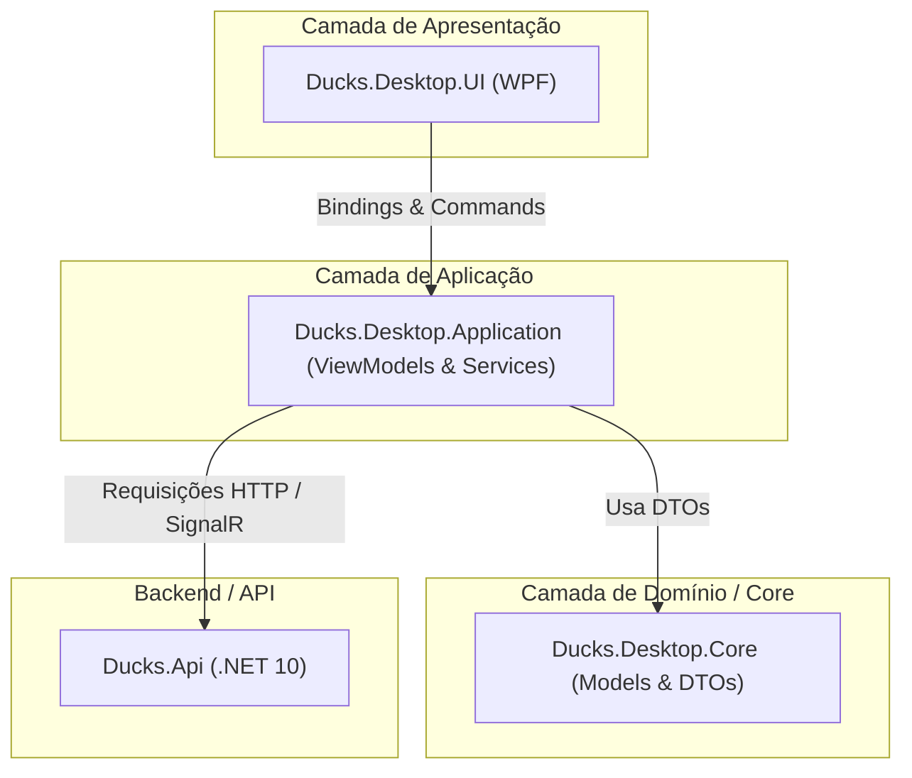
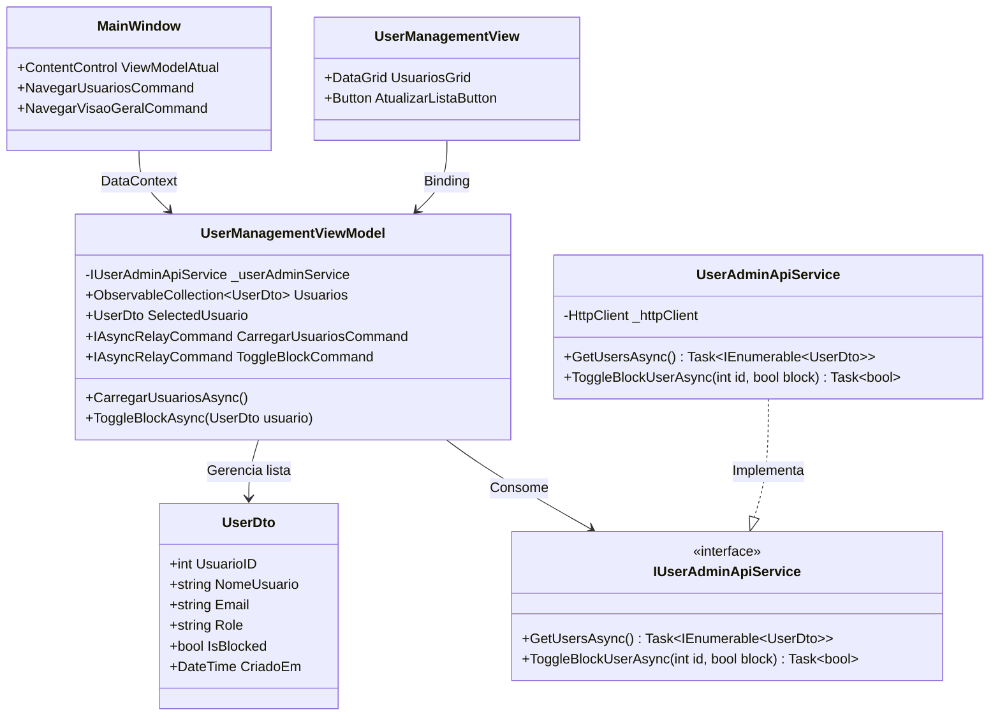
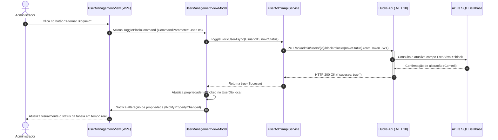

# Diagramas UML — Ducks Desktop Admin

Este documento apresenta os diagramas UML estruturais e comportamentais da aplicação desktop **Ducks.Desktop** (desenvolvida em WPF com o padrão MVVM, .NET 10), detalhando sua arquitetura, hierarquia de classes e fluxos de comunicação com a API.

---

## 1. Diagrama de Arquitetura (Camadas do Desktop)

A aplicação desktop adota uma separação estrita em três camadas/projetos para desacoplar a interface gráfica da lógica de negócio e consumo de serviços HTTP:

---

## 2. Diagrama de Classes (Padrão MVVM - Gestão de Usuários)

O diagrama abaixo ilustra as principais classes e relações do módulo de Gestão de Usuários, evidenciando o uso do padrão **MVVM** e ligação de dados (*Data Binding*):

---

## 3. Diagrama de Sequência (Fluxo de Bloqueio de Usuário)

Este diagrama demonstra a interação temporal entre a interface WPF, a camada de aplicação, o serviço de API cliente e o backend quando um administrador executa a ação de bloquear ou desbloquear um usuário:

---

## Tecnologias e Componentes do Desktop
* **Framework:** WPF (.NET 10.0 Windows)
* **Binding & Commands:** CommunityToolkit.Mvvm (`ObservableObject`, `RelayCommand`, `ObservableProperty`)
* **Comunicação:** `IHttpClientFactory` com injeção automática de token JWT Bearer.
* **Estilização:** Clean Light Theme customizado com paleta moderna e responsiva.