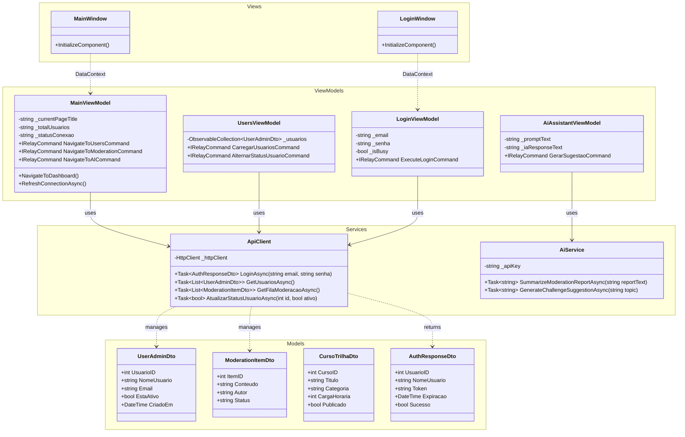
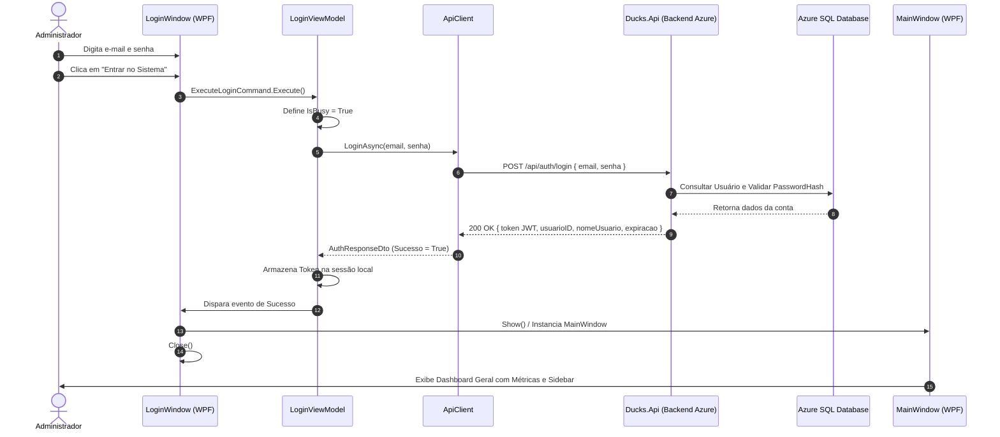

# Diagramas UML — Plataforma Educacional Gamificada Ducks

Este documento centraliza a documentação arquitetural e de modelagem UML (Unified Modeling Language) da plataforma **Ducks**. Os diagramas cobrem os aspectos de Casos de Uso, Estrutura de Classes (MVVM e Domínio), Sequência de Autenticação/Operações e Arquitetura de Componentes.

---

## 1. Diagrama de Casos de Uso (Use Case Diagram)

Descreve as interações dos atores (Administrador, Aluno/Usuário e Sistema/IA) com os principais módulos da plataforma Ducks.

```mermaid
usecaseDiagram
    actor "Administrador (Desktop)" as Admin
    actor "Aluno / Usuário (Web/Mobile)" as Student
    actor "Serviço de IA (OpenAI API)" as IAService

    rectangle "Ecossistema Ducks" {
        usecase "UC01 - Autenticar no Sistema (JWT)" as UC01
        usecase "UC02 - Gerenciar Usuários e Perfis" as UC02
        usecase "UC03 - Moderar Conteúdos e Denúncias" as UC03
        usecase "UC04 - Gerenciar Cursos e Trilhas" as UC04
        usecase "UC05 - Configurar Atividades e Desafios" as UC05
        usecase "UC06 - Auditar Pontuação de XP e Medalhas" as UC06
        usecase "UC07 - Gerar Sugestões e Resumos com IA" as UC07
        usecase "UC08 - Visualizar Dashboards e Métricas" as UC08
        usecase "UC09 - Consumir Trilhas e Realizar Atividades" as UC09
        usecase "UC10 - Receber Notificações em Tempo Real" as UC10
    }

    Admin --> UC01
    Admin --> UC02
    Admin --> UC03
    Admin --> UC04
    Admin --> UC05
    Admin --> UC06
    Admin --> UC07
    Admin --> UC08

    Student --> UC01
    Student --> UC09
    Student --> UC10

    UC07 ..> IAService : <<include>>
    UC03 ..> UC10 : <<trigger>>
```

---

## 2. Diagrama de Classes — Painel Desktop Administrativo (Pattern MVVM)

Estrutura das classes do aplicativo desktop `Ducks.Admin.Desktop` utilizando o **CommunityToolkit.Mvvm** e separação em camadas (View, ViewModel, Model, Service).



---

## 3. Diagrama de Sequência — Autenticação e Carga do Dashboard Admin

Fluxo completo de comunicação desde a entrada do usuário na `LoginWindow` até o acesso seguro à `MainWindow` consumindo a API Backend via HTTP/REST JWT.



---

## 4. Diagrama de Componentes (Component Diagram)

Visão geral dos pacotes, projetos e subsistemas da arquitetura Ducks e suas dependências.

```mermaid
graph TD
    subgraph "Camada Client Desktop (WPF)"
        [Ducks.Admin.Desktop.exe]
        [Views & Styles / Design System]
        [ViewModels (CommunityToolkit.Mvvm)]
        [ApiClient & SignalR Service]
    end

    subgraph "Testes Unitários Client"
        [Ducks.Admin.UnitTests.dll (xUnit & Moq)]
    end

    subgraph "Nuvem / Backend (.NET 10.0)"
        [Ducks.Api (Controllers / REST)]
        [Ducks.Application (Casos de Uso)]
        [Ducks.Domain (Entidades & Regras)]
        [Ducks.Infrastructure (EF Core)]
    end

    subgraph "Serviços Externos & Nuvem"
        [Azure SQL Database]
        [OpenAI API (ChatGPT)]
        [SignalR WebSocket Hub]
    end

    [Ducks.Admin.Desktop.exe] --> [Views & Styles / Design System]
    [Views & Styles / Design System] --> [ViewModels (CommunityToolkit.Mvvm)]
    [ViewModels (CommunityToolkit.Mvvm)] --> [ApiClient & SignalR Service]
    [Ducks.Admin.UnitTests.dll (xUnit & Moq)] ..> [ViewModels (CommunityToolkit.Mvvm)] : Valida

    [ApiClient & SignalR Service] -->|HTTPS / REST (JWT)| [Ducks.Api (Controllers / REST)]
    [ApiClient & SignalR Service] -->|WebSockets| [SignalR WebSocket Hub]
    [Ducks.Admin.Desktop.exe] -->|HTTP REST| [OpenAI API (ChatGPT)]

    [Ducks.Api (Controllers / REST)] --> [Ducks.Application (Casos de Uso)]
    [Ducks.Application (Casos de Uso)] --> [Ducks.Domain (Entidades & Regras)]
    [Ducks.Api (Controllers / REST)] --> [Ducks.Infrastructure (EF Core)]
    [Ducks.Infrastructure (EF Core)] --> [Azure SQL Database]
```