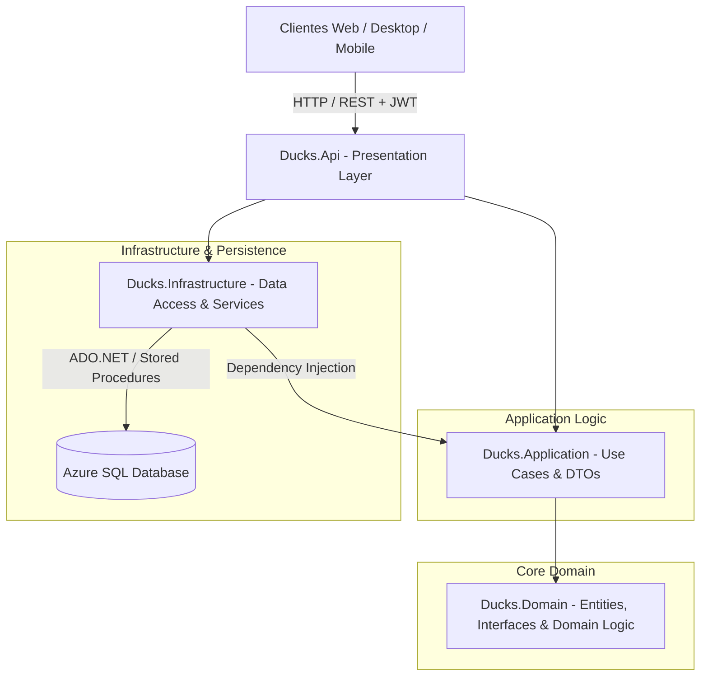
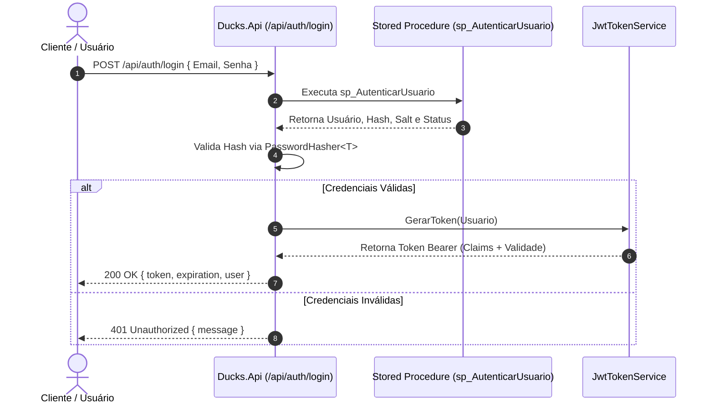
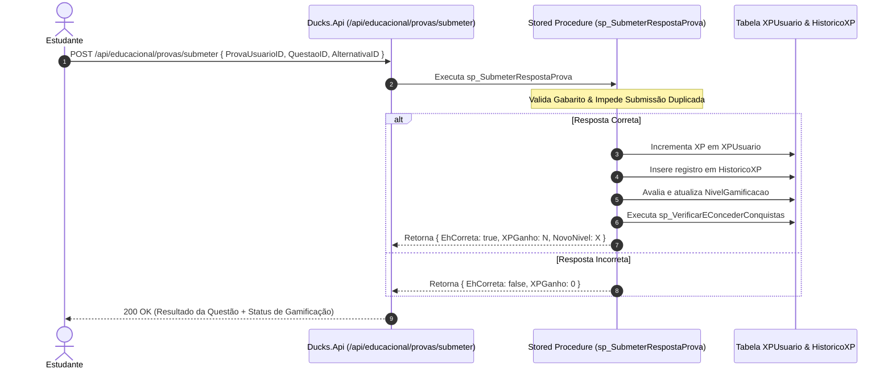

# Diagramas de Arquitetura e Fluxos do Ducks API

Este documento contém a representação visual da arquitetura e dos fluxos operacionais da **Ducks API**.

---

## 1. Arquitetura da Solução (Clean Architecture)

A API foi desenvolvida seguindo os princípios de **Clean Architecture** em **.NET 10**, garantindo o desacoplamento das regras de negócio em relação à infraestrutura e apresentação.

---

## 2. Fluxo de Autenticação JWT

---

## 3. Fluxo de Execução de Prova e Recompensa de Gamificação

