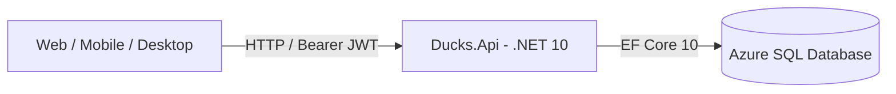

# Ducks API 

API RESTful em **.NET 10.0** com **Clean Architecture**, atuando como o ponto de acesso centralizado entre as aplicações clientes multiplataforma e o **Azure SQL Database**.

---

## Arquitetura de Acesso e Integracao

A API funciona como o **Gateway e Backend Core** da plataforma:
* Nenhuma aplicação cliente acessa o banco de dados diretamente.
* As interfaces **Web (Next.js)**, **Mobile (React Native)** e **Desktop (WPF)** realizam requisições HTTP autenticadas via **JWT**.
* A API executa as regras de negócio, validações, hashing de credenciais (`PasswordHasher<T>`) e operações de persistência via **Entity Framework Core**.

---

## Funcionalidades da API

* **Autenticação & IAM:** Cadastro de usuários, hash seguro de senhas e login com emissão de token JWT.
* **Trilhas e Conteúdo:** Consulta e gestão de matérias, trilhas de aprendizagem, módulos e aulas.
* **Gamificação (XP):** Consulta e acréscimo dinâmico de XP (pontos de experiência) e níveis por usuário.
* **Avaliações:** Gestão de banco de questões, simulados e cálculo de progresso.
* **Health Check:** Endpoint `/api/health` para monitoramento operacional.

---

## Stack Tecnológica

* **Linguagem / Framework:** C# 12, .NET 10.0 (ASP.NET Core Web API)
* **Arquitetura:** Clean Architecture (Domain, Application, Infrastructure, Api)
* **Banco de Dados:** Azure SQL Database via EF Core 10.0
* **Segurança:** JWT Bearer + `PasswordHasher<Usuario>`
* **Documentação & Testes:** OpenAPI (Swagger) e xUnit (InMemory DB)
* **Hospedagem:** Azure App Service

---

## Principais Endpoints

| Módulo | Método | Rota | Descrição |
| :--- | :--- | :--- | :--- |
| **Health** | `GET` | `/api/health` | Status de operação da API |
| **Auth** | `POST` | `/api/auth/registrar` | Novo cadastro de usuário |
| **Auth** | `POST` | `/api/auth/login` | Autenticação e geração de token JWT |
| **Conteúdo** | `GET` | `/api/educacional/trilhas` | Lista trilhas de aprendizagem disponíveis |
| **Gamificação**| `GET` | `/api/educacional/xp/{usuarioId}` | Consulta saldo de XP e nível atual |
| **Gamificação**| `POST`| `/api/educacional/xp/adicionar` | Incrementa XP por conclusão de aula/atividade |

---